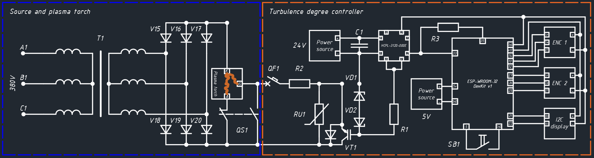

# Plasma Jet Turbulence Degree Controller (ESP32)

Firmware and hardware architecture for an isolated plasma flow turbulence degree controller designed to improve heat transfer and material deposition efficiency during electric arc plasma spraying.

<p align="center">
  
</p>

Based on research conducted at Peter the Great St. Petersburg Polytechnic University (SPbPU) and published in *Elektrichestvo* (No. 9, 2026).

---

## Overview

In plasma spraying, the hydrodynamic regime of the plasma jet directly affects heat transfer between the arc plasma and fine metallic powder particles. Experimental results demonstrate that operating the plasma jet in the **laminar-turbulent transition regime** maximizes heat transfer efficiency and increases material utilization (up to +9% efficiency gain compared to unmodulated operation) while avoiding the performance drop caused by excessive turbulence.

This controller modifies a standard plasma torch power supply circuit by introducing high-frequency, low-duty-cycle switching of a portion of the arc power between the main anode and the pilot arc (input section) electrode. This creates controlled transverse flow fluctuations without significantly altering the total average load power (<5% power deviation at duty cycles $D \le 12\%$).

---

## Key Features

* **Dual Modulation Modes:**
  * **Controlled PWM / PFM:** Independent real-time adjustment of pulse duty cycle ($D$) and switching frequency (up to **15 kHz**).
  * **Random PWM (RPWM):** Hardware-seeded pseudo-random modulation (`esp_random.h`) varying duty cycle, frequency, and pulse burst count within user-defined bounds to explore non-stationary turbulence regimes.
* **Hardware-Timed Pulse Counting:** Uses GPIO rising-edge interrupts (`gpio.h`) and a pre-populated parameter queue to eliminate generation lag during random PWM burst transitions.
* **Interactive UI & Telemetry:** Two rotary encoders with integrated pushbuttons (`ENC1`, `ENC2`), mode toggle switch (`SB1`), software debouncing, and real-time parameter display on an I2C OLED screen.
* **Power Stage Protection:** Designed to drive an IGBT switch with optocoupler isolation, collector-emitter transient voltage suppression (varistor `VDR-07D751`), gate-emitter Zener clamping (`1N5363BG`), and ballast resistance switching.

---

## Hardware & Software Stack

* **MCU:** ESP32 (`ESP-WROOM-32 DevKit v1`)
* **Framework:** ESP-IDF (`ledc.h`, `gpio.h`, `esp_random.h`)
* **Peripherals & Libraries:**
  * [async_await](https://github.com) — Non-blocking asynchronous delays
  * [button_control](https://github.com/dimakomplekt/button_control) — Button state handling & software debouncing
  * [encoder_control](https://github.com) — Rotary encoder processing
  * [ESP-I2C-OLED](https://github.com) — OLED display driver

---

## Controls & Operation

### 1. Controlled PWM Mode (Default)
* **ENC1 Rotation:** Adjusts pulse duty cycle $D$ (%).
* **ENC1 Short Press:** Toggles PWM output ON/OFF (or switches frequency step size: `1 Hz` / `100 Hz` / `1000 Hz`).
* **ENC2 Rotation:** Adjusts switching frequency $f$ (Hz).

### 2. Random PWM Mode
* **SB1 Press:** Switches from Controlled PWM to Random PWM mode (automatically disables active controlled output).
* **ENC2 Short Press:** Cycles through configurable random bounds:
  1. Duty cycle range ($D_{\min} \dots D_{\max}$)
  2. Frequency range ($f_{\min} \dots f_{\max}$)
  3. Pulse repetition count per burst ($N_{\min} \dots N_{\max}$)
* **ENC1 / ENC2 Rotation:** Adjusts lower and upper limits of the selected parameter.
* **ENC1 Long Press:** Starts or stops Random PWM generation.

---

## Citation

If you use this hardware design or firmware in your research, please cite the original paper:

```bibtex
@article{Kriskovets2026PlasmaTurbulence,
  author  = {Kriskovets, D. S. and Frolov, V. Ya. and Yushin, B. A. and Zverev, S. G. and Grachev, S. Yu. and Savel'eva, I. S.},
  title   = {The Influence of Plasma Jet Turbulence Degree on the Plasma Spraying Efficiency},
  journal = {Elektrichestvo},
  year    = {2026},
  number  = {9},
  pages   = {87--94},
  doi     = {10.24160/0013-5380-2026-9-87-94}
}
```
